# Booking lifecycle

**Accepted policy:** [issue #4](https://github.com/mikenguyen1998/restaurant-booking-platform/issues/4), approved 14 October 2026, supersedes conflicting proposals. **Pending implementation:** booking writes, arrival/hold/contact actions, corrections and booking notifications. `BookingsModule` is empty; schema fields do not establish implemented booking behavior. Availability policy is maintained in [availability and allocation](availability-and-allocation.md); authorization in [permissions](permissions.md).

## States

| Status               | Meaning                                                                       | Allocation effect                                                       |
| -------------------- | ----------------------------------------------------------------------------- | ----------------------------------------------------------------------- |
| `CONFIRMED`          | V1 booking created and allocated successfully; no owner confirmation step     | Holds resources until an authorized release or the occupied window ends |
| `CANCELLED`          | Authorized cancellation, including an explicit customer request not to attend | Release allocations; preserve history                                   |
| `COMPLETED`          | Automatic completion requires recorded arrival and end time reached           | Early completion release is unresolved (Q-26)                           |
| `NO_SHOW`            | Owner records absence after the contact/hold conditions below                 | Release allocations for the approved unreachable-guest path             |
| `PENDING`, `EXPIRED` | Reserved for a future confirmation/payment flow                               | Not created by v1; future expiry mechanics are a technical proposal     |

V1 persists new bookings directly as `CONFIRMED` in the allocation transaction. No online payment. VIP fees are shown explicitly, snapshotted at booking and collected at the restaurant. A failed allocation creates no booking. Existing bookings retain the policies accepted at creation even when restaurant settings change (Q-40); snapshot representation and application during reschedule need technical design.

## State machine

```mermaid
stateDiagram-v2
    [*] --> CONFIRMED : allocation succeeds (v1)
    CONFIRMED --> CONFIRMED : atomic reschedule
    CONFIRMED --> CANCELLED : authorized cancellation
    CONFIRMED --> COMPLETED : arrival recorded and now >= endsAt
    CONFIRMED --> NO_SHOW : owner; absent and failed contact at holdUntil + 15min
    COMPLETED --> NO_SHOW : correction with reason and audit
    NO_SHOW --> COMPLETED : correction with reason and audit
    CANCELLED --> [*]
```

The diagram is accepted behavior, not a claim of existing handlers. Owner correction is allowed within 24 hours; after that admin handles it. The reference timestamp for this window remains **unresolved decision** (Q-25), so no exact correction cutoff can yet be calculated.

## Cancellation and rescheduling

- Self-service: `deadline = startsAt − cancellationDeadlineMinutes`, default 120 minutes, configurable per restaurant. Allow **`now <= deadline`**, including the exact instant. At 19:00 with the default policy, self-service at 17:00 is allowed; after 17:00 the customer contacts the restaurant.
- Owner may process an explicit customer request after the deadline, including for an authenticated `CONFIRMED` booking, with reason, contact evidence and audit. This differs from an owner-initiated cancellation: the owner cannot cancel an authenticated confirmed booking on their own initiative; restaurant-side cancellation goes through admin.
- Owner handles guest requests for their own restaurants, including after deadline with the documented request/reason/contact evidence/audit. Guests have no self-service management link.
- Owner may cancel/reschedule manually entered bookings of their own restaurant, with reason. Audited owner operations preserve actor/time/history.
- Admin may cancel/reschedule regardless of deadline, with reason, audit and customer notification. The mechanism for a restaurant to request admin cancellation is **unresolved decision** (Q-22).
- Customer confirms they will not attend: owner may cancel immediately and release, without waiting for the hold/contact window. Reason, contact result, actor and time are mandatory, including authenticated bookings.

## Rescheduling

Date/time and party size may change. Keep booking ID and reference; revalidate capacity and allocate atomically. No fixed reschedule count limit within the self-service deadline; apply rate limiting. Owner/admin exceptions follow the authorization above.

**Technical proposal**, not implemented: lock the booking, authorize the actor and request, validate the new slot, release old allocations and allocate the new candidate in one transaction. Commit new times/party size, history and side effects only on success. Failure rolls back everything, preserving the old times, party size and active allocations. Isolation, locking, retries, snapshot versioning and rate-limit parameters remain technical design work; see [T-01–T-04](../open-questions.md#technical-decisions).

## Arrival, hold and contact

**Accepted policy** (#4 section 1):

1. Owner records `arrivedAt` (“Guest arrived”). Arrived bookings do not receive late-arrival alerts.
2. Initially `holdUntil = startsAt + 15 minutes`. If still absent at that deadline, alert the owner. Do not automatically cancel, mark `NO_SHOW` or release resources.
3. Owner must attempt contact before deciding the outcome; record actor, time and contact outcome.
4. Owner may extend `holdUntil`; alert again if still absent. This changes only the waiting deadline, never the meal start/end or occupied interval.
5. At **effective `holdUntil + 15 minutes`**, if still absent and contact attempts failed, the owner may manually mark `NO_SHOW` and release allocations. An alert alone cannot authorize this transition.
6. A confirmed customer request not to attend allows immediate cancellation as above.
7. If the customer arrives after release, create a new booking subject to current availability. Never force restoration of the old allocation over another booking.

Example: start 19:00 → initial hold 19:15 → contact window to 19:30. Owner may record `NO_SHOW`/release at 19:30 only if the guest remains absent and contact failed. Extending hold to 19:25 moves that threshold to 19:40 without changing the original meal end.

**Pending technical design:** storage and validation of `arrivedAt`, contact attempts, hold extensions, alert scheduling/deduplication and races with arrival/cancellation. No extension limit or contact-attempt count was approved; do not invent one.

## Completion and correction

Auto-complete only when **status is `CONFIRMED`, `arrivedAt` is recorded and `now >= endsAt`**. Absent/unresolved bookings remain pending owner action and produce reminders; “pending owner action” does not mean a transition to `PENDING`. A conditional update must not overwrite a concurrent owner action (technical enforcement pending).

Owner can correct `COMPLETED ↔ NO_SHOW` within 24 hours, with reason/audit; admin handles later corrections. **Unresolved decision:** which timestamp anchors the 24-hour window. Do not choose `endsAt`, `completedAt`, `noShowAt` or correction time without approval.

When a booking changes to `NO_SHOW`, temporarily hide any existing review, preserve its history and route it to admin review. Automatic restoration and release behavior for early `COMPLETED` remain unresolved; correction must not silently recreate released allocations.

## Events and notifications

**Accepted policy** (#4 sections 3–5):

- Send one immediate “Booking successful” confirmation, not separate CREATED and CONFIRMED customer messages. Internal history events may be separate; their representation is technical design.
- Customers and guests supplying an email receive booking emails. Guest email is optional.
- Skip 24-hour/2-hour reminders whose scheduled send time has already passed when the booking is created; confirmation still sends immediately.
- Opt-out applies only to reminder emails. Confirmation and important booking-change emails still send.
- Admin cancellation/reschedule notifies the customer; hold/contact alerts and unresolved-absence reminders follow the rules above.

**Technical proposal:** booking events/audit and transactional outbox are written with the change; worker delivery is idempotent. **Pending technical design:** reminder cancellation/rescheduling, alert payloads, stale job handling and secure guest delivery. These structures and booking worker flows are not implemented.

## Idempotency

Same authorized actor + key + same intent returns the same booking. Same key with a different request fingerprint returns conflict, without editing the existing booking. Authorization must precede private replay; a key alone is not access permission. Example: retry the same authorized request → same booking; change time or party size under that key → conflict, use the reschedule flow to change it.

**Pending technical design:** [issue #12](https://github.com/mikenguyen1998/restaurant-booking-platform/issues/12) owns secure guest scoping, private replay DTOs, key storage/fingerprint and transport details. No global unscoped unique key policy is implied.
